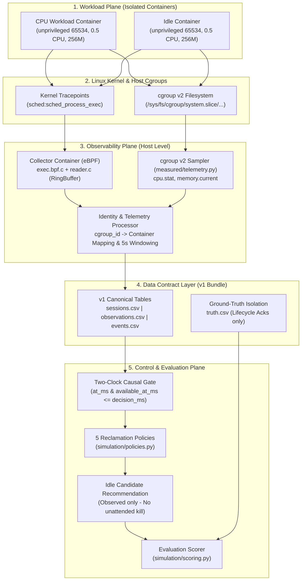

# 02 — Kiến trúc Hệ thống & Các Thành phần Chức năng

Hệ thống **OpenLab-Scale** được thiết kế theo mô hình đường ống phân tầng trên một máy chủ Linux độc lập, phân tách tuyệt đối giữa **Tầng Thu thập (Observability Plane)**, **Tầng Quyết định & Thu hồi (Control Plane)**, và **Tầng Đánh giá Thực nghiệm (Evaluation Plane)**.

---

## Chi tiết Các Mô-đun Hệ thống

### M1. Synthetic Workload Generator & Measured Worker
* **Offline (`simulation/generator.py`, `simulation/scenarios.py`)**: Sinh chuỗi phiên giả lập tất định (10 mẫu kịch bản: tương tác thuần, nền CPU, batch I/O, xung ngắn, nhàn rỗi, lỗi suy giảm tín hiệu) dựa trên thuật toán sinh số giả ngẫu nhiên có seed SHA-256 (`seed=42`).
* **Live (`measured/worker.py`)**: Tác tử công việc chạy trong container thực tế với quyền người dùng không đặc quyền (`65534:65534`, `cap_drop: [ALL]`, `read_only: true`, `network_mode: none`). Tác tử thực thi các pha tính toán CPU (băm ma trận bận) hoặc ngủ nghỉ tĩnh lặng theo đúng lịch trình đã định sẵn.

### M2. eBPF Kernel Collector (`collector/`)
* **Kiến trúc**: Triển khai bằng C nguyên bản sử dụng thư viện `libbpf` và nhân vật lý hạt nhân qua `BTF` (`/sys/kernel/btf/vmlinux`).
* **Probe hạt nhân (`collector/exec.bpf.c`)**: Đính kèm vào tracepoint `sched:sched_process_exec`. Khi tiến trình con được thực thi trong container, kernel probe trích xuất `pid`, `tgid`, `cgroup_id`, tên lệnh `comm` và đẩy vào cấu trúc dữ liệu BPF Ring Buffer hiệu năng cao kèm bộ đếm rơi rụng `event_loss`.
* **Bộ đọc người dùng (`collector/reader.c`)**: Đọc luồng dữ liệu từ ring buffer và xuất ra chuẩn JSON Lines (JSONL) kèm cờ hiệu kiểm soát lỗi.

### M3. cgroup v2 Sampler (`measured/telemetry.py`)
* Thu thập trực tiếp từ hệ thống tệp cgroup v2 của máy chủ tại `/sys/fs/cgroup`.
* Lấy mẫu các chỉ số định lượng: `usage_usec`, `user_usec`, `system_usec` từ `cpu.stat`, hạn mức `cpu.max` và dung lượng RAM tức thời `memory.current`.
* Tất cả số liệu được tính toán gia số (deltas) trên chu kỳ lấy mẫu và gắn nhãn nguồn gốc `provenance: 'cgroup_v2'`.

### M4. Identity & Telemetry Processor (`measured/telemetry.py`, `simulation/observations.py`)
* **Ánh xạ định danh**: Ghép nối `cgroup_id` 64-bit từ sự kiện hạt nhân eBPF sang đường dẫn cgroup và Docker Container ID tương ứng của phiên làm việc.
* **Chống định danh cũ (*Anti-Stale Attribution*)**: Kiểm tra vòng đời và kiểm tra khởi động lại; khi container dừng hoặc bị tạo lại, bảng ánh xạ PID/cgroup cũ bị hủy bỏ lập tức nhằm ngăn ngừa việc ghi nhận nhầm sự kiện của tiến trình khác vào container đã kết thúc.
* **Gom cụm cửa sổ quan sát (*5s Windowing*)**: Tổng hợp các gia số CPU, RAM, và số lượng sự kiện eBPF vào các cửa sổ quan sát chuẩn hóa kéo dài cố định 5000ms (`window_start_ms` đến `window_end_ms`).

### M5. Rule-Based Activity Detector / Policy Engine (`simulation/policies.py`)
* Đánh giá luồng quan sát sau khi qua cổng nhân quả (*Causal Gate*).
* Phân loại trạng thái container thành 4 nhãn:
  1. `ACTIVE`: Mức CPU vượt ngưỡng kích hoạt (`cpu_threshold_pct`, mặc định 1.0%) hoặc có sự kiện tiến trình/tương tác hợp lệ.
  2. `IDLE`: Cả CPU lẫn sự kiện đều dưới ngưỡng yên lặng liên tục trong khoảng thời gian `quiet_ms` (mặc định 30s) và vượt qua thời gian trễ ổn định `hysteresis_ms` (mặc định 10s).
  3. `MIXED`: Có xung hoạt động ngắn xen kẽ hoặc đang ở trạng thái chuyển giao pha — duy trì container sống, không đề xuất thu hồi.
  4. `UNKNOWN`: Tín hiệu bị suy giảm (*Degraded*), thiếu trường số liệu hoặc telemetry quá hạn (*stale*) — khóa cứng việc đề xuất thu hồi.

### M6. Resource Controller (`measured/run.py`)
* Nhận khuyến nghị `IDLE_CANDIDATE` từ Detector.
* Khuyến nghị chỉ mang tính chất quan sát (*observational*), không tự ý hủy container.
* Trong kịch bản thu hồi hoàn chỉnh, bộ điều khiển yêu cầu:
  1. Telemetry phải ở trạng thái hợp lệ (không suy giảm).
  2. Phê duyệt rõ ràng từ quản trị viên qua giao diện điều hành.
  3. Xác thực hàng rào định danh (*fencing check*) qua `docker inspect` ngay trước khi gọi `docker stop` để đảm bảo container không bị tái sinh hoặc đổi trạng thái.

### M7. Evaluation & Scoring Pipeline (`simulation/scoring.py`, `tests/live_measured.py`)
* So sánh khuyến nghị của các chính sách với nhãn chuẩn *Ground-Truth* (`truth.csv`).
* Tính toán các chỉ số kiểm chứng: Ma trận nhầm lẫn (Confusion Matrix), Precision, Recall, F1-Score, Tỷ lệ thu hồi nhầm (*False Reclaim Rate*), Tỷ lệ bắt trúng nhàn rỗi (*Idle Capture Rate*), và Tỷ lệ từ chối (*Abstention Rate*).
